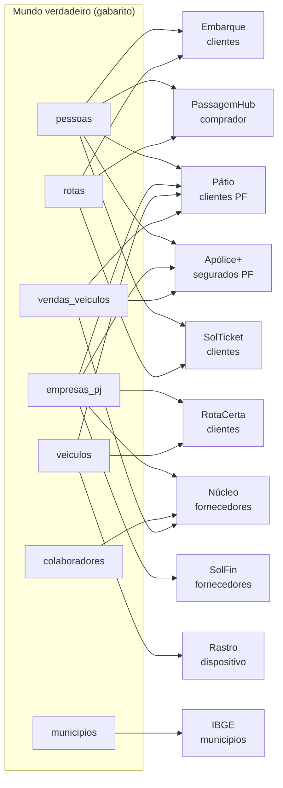

# Bases de dados do Grupo ModelBricks

Esta pasta documenta as bases de dados fictícias que o gerador entrega na landing: os nove sistemas de origem do Grupo ModelBricks, o arquivo de referência do IBGE e o `gabarito`. Cada documento traz um diagrama entidade-relacionamento (ER) em Mermaid, o dicionário de dados de cada entidade e as regras que explicam como os dados mudam ao longo do tempo.

O [README do gerador](../README.md) explica de onde os dados vêm, como os catálogos são organizados e como funciona o relógio simulado. Aqui o foco é **o que está dentro dos arquivos**.

## Bases documentadas

| Base | Empresa | Entrega | Formato | Entidades | Artigos |
|---|---|---|---|---|---|
| [*Embarque*](embarque.md) | ModelBricks Viação | CDC (`I`/`U`/`D`) | JSON lines | `clientes`, `tarifas`, `passagens` | 01, 02, 03, 04, 05, 06, 07, 10 |
| [*PassagemHub*](passagemhub.md) | marketplace parceiro da Viação | API paginada | JSON aninhado | `eventos_venda` | 01, 04, 05, 06, 07, 10 |
| [*Pátio*](patio.md) | ModelBricks Veículos | snapshot completo | CSV | `lojas`, `clientes`, `veiculos`, `vendas`, `ordens_servico` | 01, 02, 03, 08, 10 |
| [*Rastro*](rastro.md) | telemetria da frota própria | stream simulado em arquivos | JSON lines aninhado | `eventos` | 01, 09, 10 |
| [*Núcleo*](nucleo.md) | ERP corporativo da holding | incremental por `updated_at`, com *soft delete* | Parquet | `colaboradores`, `fornecedores`, `titulos_pagar`, `notas_fiscais`, `ativos` | 01, 02, 03, 10 |
| [*RotaCerta*](rotacerta.md) | ModelBricks Cargas | CDC (`I`/`U`) | JSON lines | `clientes`, `caminhoes`, `fretes` | 01, 02, 04, 09, 10 |
| [*Apólice+*](apolice.md) | ModelBricks Seguros | incremental por `updated_at` | CSV | `segurados`, `apolices` | 01, 03, 10 |
| [*SolTicket*](solticket.md) | Expresso Vale do Sol (legado) | carga histórica e snapshots semanais | CSV `;` em `latin1` | `clientes`, `linhas`, `passagens` | 01, 05, 06, 10 |
| [*SolFin*](solfin.md) | Expresso Vale do Sol (legado) | carga histórica e snapshots semanais | CSV `;` em `latin1` | `fornecedores`, `titulos_pagar` | 01, 05, 06, 10 |
| [IBGE](ibge.md) | dado público de referência | arquivo único na carga inicial | CSV | `municipios` | 01, 08, 10 |
| [`gabarito`](gabarito.md) | mundo verdadeiro (não é sistema de origem) | tabelas Delta no catálogo Silver | Delta | 10 tabelas do mundo, `mapa_chaves` e `defeitos` | 03, 05, 06, 10 |

A coluna **Artigos** diz em quais artigos a base é usada. Todas chegam à Bronze no artigo 01, porque a série constrói um único lakehouse: o `00_setup` grava todos os sistemas, conforme a seção `carga:` do [`roteiro.yaml`](../src/modelbricks_gerador/roteiro.yaml), e os artigos seguintes leem a mesma Bronze. No `gabarito`, a coluna diz quais artigos o usam para conferir a solução.

## Como as bases se conectam

Nenhum sistema enxerga o outro. Todos são projeções do mesmo **mundo verdadeiro**: cada sistema escolhe a parte do mundo que lhe interessa e a registra com chave e grafia próprias. A mesma pessoa pode ser `id_cliente` no *Embarque*, `PH…` no *PassagemHub*, `codigo_segurado` no *Apólice+* e `cod_cliente` no *SolTicket*, sem nenhuma coluna em comum que diga que é a mesma pessoa.

O que permite ligar os sistemas na Silver:

- **Documentos e placa.** CPF, CNPJ e placa vêm do mundo verdadeiro e são únicos e válidos. São o caminho natural de integração, mas aparecem com grafias diferentes (com e sem máscara, por exemplo) e com defeitos.
- **Código de município do IBGE.** Todos os endereços, rotas, lojas e bases usam o `cod_municipio` do IBGE (7 dígitos), salvo o defeito "município fora do padrão".
- **`gabarito.mapa_chaves`.** Liga cada chave de sistema ao id verdadeiro. Serve para **conferir** a integração feita pelo pipeline, não para fazê-la.

## Como ler os documentos

**Diagramas.** Os arquivos da landing não têm restrições de chave: `PK` e `FK` nos diagramas indicam a chave lógica de cada entidade e as referências que o sistema de origem respeita. Os tipos são os **tipos lógicos** dos valores (`bigint`, `string`, `date`, `timestamp`, `decimal`, `boolean`). Em CSV e JSON tudo chega como texto ou número JSON; só o Parquet do *Núcleo* traz os tipos físicos. A precisão dos decimais está no dicionário de dados.

**Colunas de controle.** Cada padrão de entrega acrescenta colunas próprias, que não existem no sistema "de verdade":

| Padrão | Colunas de controle | Significado |
|---|---|---|
| CDC (*Embarque*, *RotaCerta*) | `op`, `seq`, `ts_operacao` | Operação (`I`, `U` ou `D`), sequencial único e crescente por sistema e instante da operação. No `D`, a linha traz só a chave e as colunas de controle. |
| Incremental (*Núcleo*, *Apólice+*) | `updated_at`, e `excluido` no *Núcleo* | Instante da mudança. A linha traz a imagem completa do registro depois dela. |
| Snapshot (*Pátio*, *SolTicket*, *SolFin*) | nenhuma | Cada arquivo é a foto inteira da tabela na data da pasta. A exclusão aparece como ausência na foto seguinte. |
| API e stream (*PassagemHub*, *Rastro*) | `id_evento` e o instante do evento | O evento é imutável; a mudança de estado vem como evento novo. |

**Caminho dos arquivos.** Todo arquivo fica em `/Volumes/bronze_<amb>/<sistema>/landing/<entidade>/<AAAA-MM-DD>/<entidade>_<AAAAMMDD>_<NNNN>.<ext>`, onde a data é a do dia simulado em que o lote chegou.

**Defeitos.** Cada documento lista os defeitos que o roteiro aplica àquele sistema. Eles estão nos arquivos desde a carga inicial, e cada defeito entregue tem registro em `gabarito.defeitos`.

**Volumes.** Os números citados são da escala 1, de 01/01/2024 até a carga inicial em 31/12/2025. A variável `escala` do job multiplica todos linearmente. A exceção é a janela de telemetria do *Rastro* na carga inicial (90 dias), que não muda com a escala.
