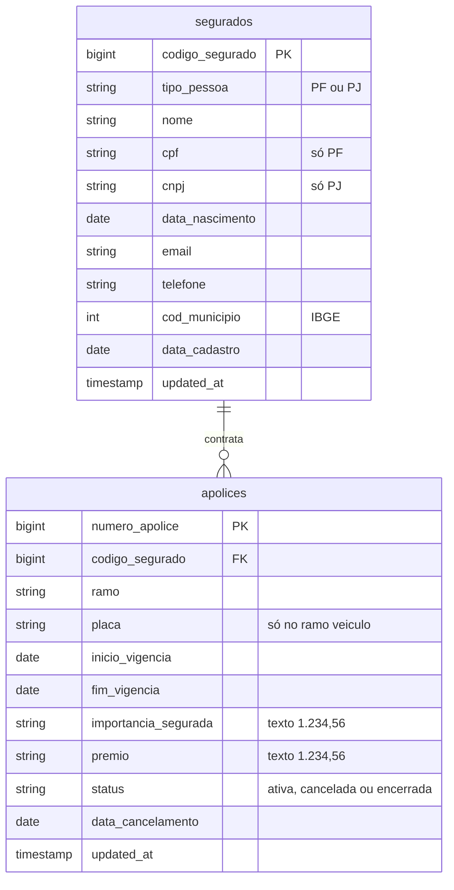

# *Apólice+*: apólices da ModelBricks Seguros

Sistema de apólices da corretora do grupo. Como o [*Núcleo*](nucleo.md), entrega **incremental por `updated_at`**, mas em CSV e sem *soft delete*: o fim de uma apólice é uma mudança de `status`. Os valores monetários chegam como texto no formato brasileiro (`1.234,56`).

| | |
|---|---|
| Schema na Bronze | `apolice` |
| Formato | CSV com cabeçalho, separador `,`, UTF-8. Textos entre aspas, nulos como campo vazio, datas `AAAA-MM-DD` e instantes `AAAA-MM-DD HH:MM:SS` |
| Arquivos | um por entidade e dia com mudanças: `apolice/<entidade>/<AAAA-MM-DD>/<entidade>_<AAAAMMDD>_0001.csv` |
| Entidades | `segurados`, `apolices` |
| Volume (escala 1) | 8 mil apólices avulsas em 2024 e 2025, mais as vendidas junto com veículos |
| Fatias | 03 e 10 |

## Diagrama ER

## Dicionário de dados

### `segurados`

Clientes da ModelBricks Seguros no mundo verdadeiro, pessoas físicas e jurídicas, cadastrados no dia em que se tornaram clientes. Quem também viaja pela Viação aparece no *Apólice+* e no *Embarque*, com chaves diferentes.

| Coluna | Tipo | Descrição |
|---|---|---|
| `codigo_segurado` | bigint | Chave do sistema, com 8 dígitos. |
| `tipo_pessoa` | string | `PF` ou `PJ`. |
| `nome` | string | Nome da pessoa ou razão social. |
| `cpf` | string | CPF, 11 dígitos sem máscara; vazio para PJ. |
| `cnpj` | string | CNPJ, 14 dígitos sem máscara; vazio para PF. |
| `data_nascimento` | date | Só para PF. |
| `email` | string | E-mail. |
| `telefone` | string | Telefone `(DD) 9NNNN-NNNN`. |
| `cod_municipio` | int | Município do endereço (IBGE). |
| `data_cadastro` | date | Dia em que se tornou cliente da seguradora. |
| `updated_at` | timestamp | Instante da mudança. |

**Versões:** o cadastro e trocas de telefone (cerca de 20% dos segurados por ano).

### `apolices`

Fato do sistema, de duas origens:

- **Avulsas:** emitidas dia a dia, na proporção dos segurados já cadastrados. PF contratam `vida`, `residencial` ou `viagem`; PJ contratam `empresarial`, `responsabilidade_civil` ou `transporte`.
- **Vendidas com veículos:** 60% das vendas de veículo do mundo verdadeiro a um segurado já cadastrado levam o seguro, no ramo `veiculo`, com a placa e a importância segurada igual ao valor da venda.

| Coluna | Tipo | Descrição |
|---|---|---|
| `numero_apolice` | bigint | Chave: `AAAAMMDD` da emissão seguido de um sequencial de 5 dígitos (a partir de 90001 nas vendidas com veículos). |
| `codigo_segurado` | bigint | Segurado (FK para `segurados`). |
| `ramo` | string | `vida`, `residencial`, `viagem`, `empresarial`, `responsabilidade_civil`, `transporte` ou `veiculo`. |
| `placa` | string | Placa do veículo segurado; vazia nos demais ramos. |
| `inicio_vigencia` | date | Dia da emissão. |
| `fim_vigencia` | date | 12 meses depois, menos um dia. |
| `importancia_segurada` | string | Valor segurado, como texto `1.234,56`. Avulsas: de R$ 20 mil a R$ 2 milhões. |
| `premio` | string | Prêmio anual, como texto `1.234,56`. De 0,5% a 3% da importância segurada (2% a 5% no ramo `veiculo`). |
| `status` | string | `ativa`, `cancelada` ou `encerrada`. |
| `data_cancelamento` | date | Preenchida só no cancelamento. |
| `updated_at` | timestamp | Instante da mudança. |

**Versões:** a emissão (`ativa`); depois, o cancelamento durante a vigência (8% das apólices) ou o encerramento no dia seguinte ao fim da vigência.

## Ligação com o mundo verdadeiro

Em `gabarito.mapa_chaves` (fatias com gabarito):

| Entidade | Coluna | Tabela verdadeira |
|---|---|---|
| `segurados` | `codigo_segurado` | `pessoas` (PF) ou `empresas_pj` (PJ) |

As apólices vendidas com veículos se ligam ao mundo pela `placa`.

## Defeitos

| Defeito | Taxa | Como aparece |
|---|---|---|
| Valor monetário como texto | coluna inteira | `importancia_segurada` e `premio` no formato brasileiro (`1.234,56`), em todas as linhas. Registrado uma vez por arquivo e coluna, com um exemplo do valor sujo e do original. |
| CPF fora do padrão | 5% dos segurados PF | CPF com máscara (`000.000.000-00`) ou sem os zeros à esquerda. |

O *Apólice+* só aparece em fatias com gabarito. Numa fatia sem gabarito, os valores monetários sairiam como número.
