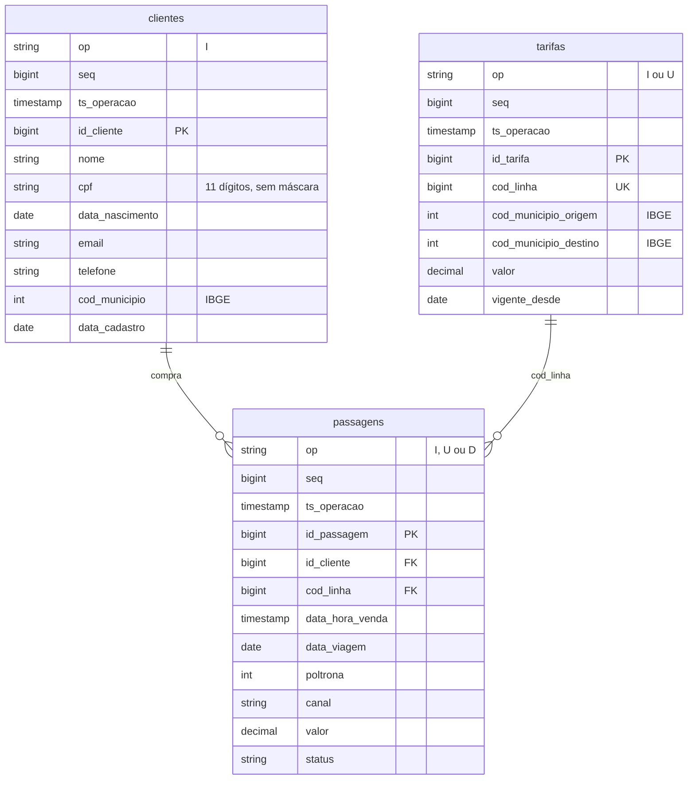
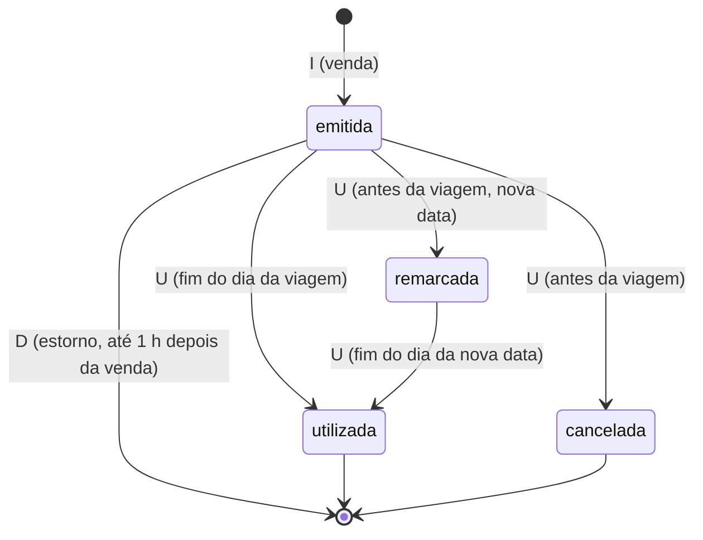

# *Embarque*: bilhetagem da ModelBricks Viação

Sistema de venda de passagens de ônibus da ModelBricks Viação, usado no guichê e no site. Entrega um **log de CDC**: cada linha é uma operação (`I`, `U` ou `D`) sobre um registro, na ordem em que aconteceu.

| Schema na Bronze  | `embarque`                                                                                              |
| ----------------- | ------------------------------------------------------------------------------------------------------- |
| Formato           | JSON lines (um objeto JSON por linha)                                                                   |
| Arquivos          | um por entidade e dia simulado: `embarque/<entidade>/<AAAA-MM-DD>/<entidade>_<AAAAMMDD>_0001.json`      |
| Entidades         | `clientes`, `tarifas`, `passagens`                                                                      |
| Volume (escala 1) | cerca de 360 mil passagens em 2024 e 2025 (60% das vendas da Viação; o restante sai pelo *PassagemHub*) |
| Artigos            | 01, 02, 03, 04, 05, 06, 07 e 10 |

## Diagrama ER

## Envelope de CDC

As três entidades compartilham as colunas de controle, que vêm antes da chave em cada linha:

| Coluna | Tipo | Descrição |
|---|---|---|
| `op` | string | `I` (inserção), `U` (atualização) ou `D` (exclusão). |
| `seq` | bigint | Sequencial único e crescente **no sistema inteiro**, pela ordem de entrega. Use para ordenar as operações de uma mesma chave. |
| `ts_operacao` | timestamp | Instante em que a operação aconteceu no sistema. |

- Nas operações `I` e `U`, a linha traz a imagem **completa** do registro depois da mudança.
- No `D`, a linha traz só `op`, `seq`, `ts_operacao` e a chave. As demais colunas são omitidas do JSON.
- A primeira operação de toda chave é um `I`, e nada vem depois de um `D`.

## Dicionário de dados

### `clientes`

Pessoas clientes da Viação, vindas do mundo verdadeiro. Cada cliente tem uma única operação `I`, de madrugada, no dia em que se tornou cliente. O *Embarque* não registra mudanças cadastrais.

| Coluna | Tipo | Descrição |
|---|---|---|
| `id_cliente` | bigint | Chave do sistema, com 9 dígitos. |
| `nome` | string | Nome completo. |
| `cpf` | string | CPF com 11 dígitos, sem máscara. |
| `data_nascimento` | date | Data de nascimento. |
| `email` | string | E-mail. |
| `telefone` | string | Telefone no formato `(DD) 9NNNN-NNNN`. |
| `cod_municipio` | int | Município de residência, código do IBGE. |
| `data_cadastro` | date | Dia em que a pessoa se tornou cliente da Viação. |

### `tarifas`

Uma tarifa por linha de ônibus da Viação. Cada tarifa nasce com um `I` à 0h de 01/01/2024 e recebe um `U` à 0h de 12/01/2026, no **reajuste de tarifas em massa** (+8,5% em todas). É o lote com o maior número de atualizações de uma só vez.

| Coluna | Tipo | Descrição |
|---|---|---|
| `id_tarifa` | bigint | Chave do sistema, com 7 dígitos. |
| `cod_linha` | bigint | Código da linha de ônibus, com 6 dígitos. É a coluna que as `passagens` referenciam. |
| `cod_municipio_origem` | int | Município de origem da linha (IBGE). |
| `cod_municipio_destino` | int | Município de destino da linha (IBGE). |
| `valor` | decimal(10,2) | Valor da tarifa, em R$. |
| `vigente_desde` | date | Início da vigência do valor. |

### `passagens`

Fato do sistema: as passagens não existem no mundo verdadeiro. O `valor` é a tarifa vigente no dia da venda.

| Coluna | Tipo | Descrição |
|---|---|---|
| `id_passagem` | bigint | Chave: `AAAAMMDD` da venda seguido de um sequencial de 5 dígitos. |
| `id_cliente` | bigint | Cliente que comprou (FK para `clientes`). |
| `cod_linha` | bigint | Linha da viagem (FK para `tarifas.cod_linha`). |
| `data_hora_venda` | timestamp | Instante da venda, entre 06h e 22h. |
| `data_viagem` | date | Data da viagem: 0 a 30 dias depois da venda, ou a nova data após uma remarcação. |
| `poltrona` | int | Poltrona, de 1 a 46. |
| `canal` | string | `guiche` ou `site`. |
| `valor` | decimal(10,2) | Valor pago, em R$. |
| `status` | string | `emitida`, `remarcada`, `cancelada` ou `utilizada`. |

**Ciclo de vida de uma passagem:**

- Cerca de 1% das passagens é estornada (`D`), 4% cancelada e 5% remarcada (de 1 a 15 dias depois). As demais são utilizadas.
- Passagem vendida para o mesmo dia nunca é cancelada nem remarcada.

## Ligação com o mundo verdadeiro

Em `gabarito.mapa_chaves`:

| Entidade | Coluna | Tabela verdadeira |
|---|---|---|
| `clientes` | `id_cliente` | `pessoas` |
| `tarifas` | `id_tarifa` | `rotas` |
| `tarifas` | `cod_linha` | `rotas` |

## Defeitos

| Defeito | Taxa | Como aparece |
|---|---|---|
| CDC duplicado | 1% das operações | A mesma operação chega de novo de 1 a 2 dias depois, com a **mesma `seq`** da original. |

O código do gerador também sabe aplicar ao *Embarque* pessoa duplicada, CPF fora do padrão, nome abreviado, contato nulo, evento atrasado e FK órfã, mas o roteiro não liga esses defeitos para este sistema.
