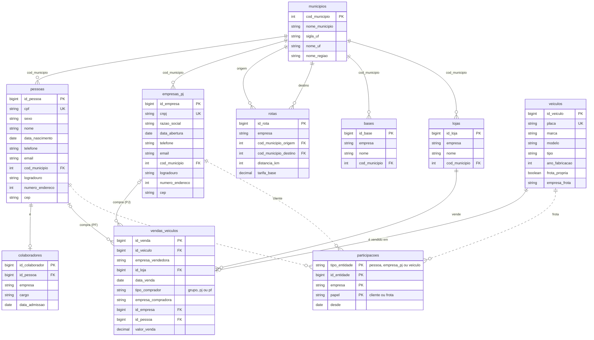
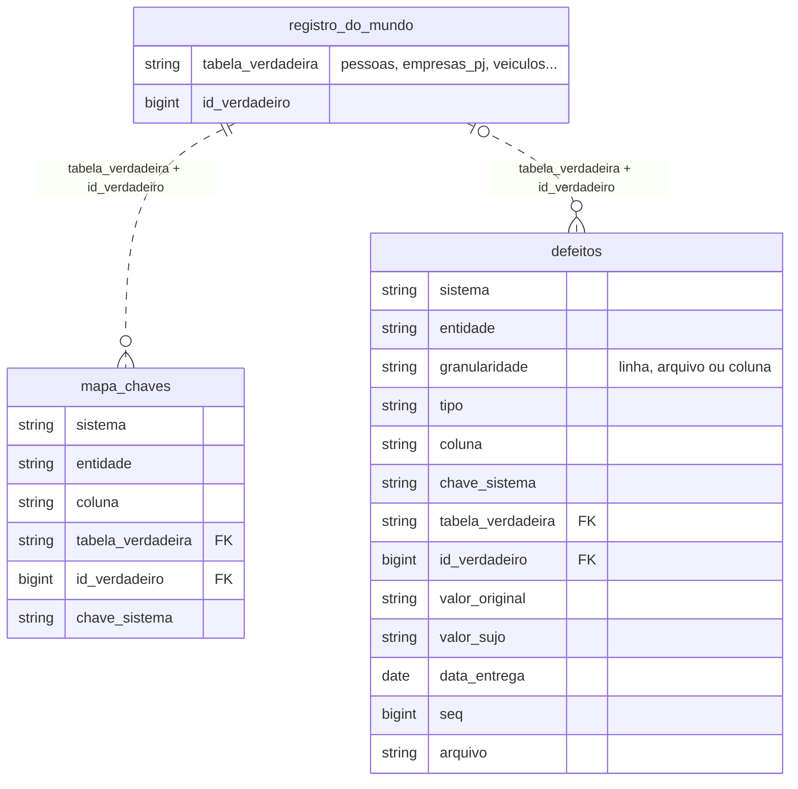

# `gabarito`: o mundo verdadeiro

O `gabarito` não é um sistema de origem. É a **resposta certa**: as entidades do Grupo ModelBricks como elas são de fato, com as chaves verdadeiras, antes de cada sistema registrá-las do seu jeito. Ele serve para conferir o trabalho do pipeline: se a integração de clientes da Silver juntou as pessoas certas, se cada defeito foi tratado e se as contagens batem.

| | |
|---|---|
| Onde fica | schema `gabarito` do catálogo **Silver** do artigo: `aNN_silver_<amb>.gabarito` |
| Formato | tabelas Delta gravadas pelo gerador (nunca arquivos na landing) |
| Tabelas | as 10 do mundo verdadeiro, mais `mapa_chaves` e `defeitos` |
| Fatias | só 03, 05, 06 e 10; nas demais, o schema não existe |

O mundo verdadeiro é gerado inteiro em **toda** fatia, mesmo nas que não gravam o gabarito: é dele que os sistemas projetam os seus dados. Por isso, o mesmo cliente tem os mesmos dados em todos os artigos.

## Diagrama ER do mundo verdadeiro

As linhas pontilhadas são referências polimórficas: `participacoes.id_entidade` aponta para `pessoas`, `empresas_pj` ou `veiculos`, conforme o `tipo_entidade`.

Em `municipios`, o diagrama mostra só as colunas principais. A tabela tem as mesmas 12 colunas do [arquivo do IBGE](ibge.md).

## Empresas do grupo

As colunas `empresa`, `empresa_frota`, `empresa_vendedora` e `empresa_compradora` usam estes códigos:

| Código | Empresa |
|---|---|
| `mb` | Grupo ModelBricks (holding) |
| `mb_viacao` | ModelBricks Viação (transporte de passageiros) |
| `mb_cargas` | ModelBricks Cargas (transporte de cargas) |
| `mb_veiculos` | ModelBricks Veículos (concessionária de ônibus e caminhões) |
| `mb_seguros` | ModelBricks Seguros (corretora) |
| `evs` | Expresso Vale do Sol (adquirida em 01/07/2025) |

## Dicionário de dados do mundo verdadeiro

| Tabela | Chave | Volume (escala 1) | Conteúdo |
|---|---|---|---|
| `municipios` | `cod_municipio` | 5.571 | Municípios, UFs e regiões do IBGE. |
| `pessoas` | `id_pessoa` | 20.000 | Pessoas físicas: CPF válido e único, nome, sexo, nascimento (18 a 85 anos), contato e endereço. |
| `empresas_pj` | `id_empresa` | 1.500 | Empresas clientes e fornecedoras: CNPJ válido e único, razão social, abertura, contato e endereço. |
| `veiculos` | `id_veiculo` | 3.000 | Ônibus e caminhões com placa Mercosul única. Os 400 primeiros são a frota própria: ônibus para a `mb_viacao` e caminhões para a `mb_cargas` (`empresa_frota`). |
| `vendas_veiculos` | `id_venda` | 3.000 | Uma venda por veículo, sempre pela `mb_veiculos` numa loja dela. A frota própria vai para o grupo (`tipo_comprador = grupo`); os demais, para clientes PJ (70%) ou PF. |
| `rotas` | `id_rota` | 120 | Linhas de ônibus da `mb_viacao` (80%) e da `evs` (20%), entre municípios diferentes, com tarifa de R$ 0,32 por km. |
| `bases` | `id_base` | 30 | Garagens da Viação e do Vale do Sol e centros de distribuição da Cargas. |
| `lojas` | `id_loja` | 15 | Lojas da `mb_veiculos` (60%) e da `mb_seguros` (40%). |
| `colaboradores` | `id_colaborador` | 1.500 | Vínculo de uma pessoa com uma empresa do grupo: cargo e admissão. Cada pessoa tem no máximo um vínculo. |
| `participacoes` | `tipo_entidade`, `id_entidade`, `empresa`, `papel` | — | Quem é cliente de quem (`papel = cliente`) e de quem é cada veículo da frota (`papel = frota`), com a data de início (`desde`). |

**Participações.** Cada pessoa é cliente de uma empresa principal (Viação 70%, Vale do Sol 15%, Seguros 10%, Veículos 5%), e 15% das pessoas são clientes também de uma segunda empresa. Cada empresa PJ é cliente da Cargas (70%), da Veículos (20%) ou da Seguros (10%), e 20% delas de uma segunda empresa. É essa sobreposição que faz o mesmo cliente aparecer em vários sistemas.

## `mapa_chaves`

Liga cada chave de sistema ao registro verdadeiro que ela representa. Uma pessoa cliente da Viação e da Seguros tem, por exemplo, uma linha para o `id_cliente` do *Embarque*, outra para o `id_cliente` do *PassagemHub* e outra para o `codigo_segurado` do *Apólice+*, todas com o mesmo `id_verdadeiro`.

| Coluna | Tipo | Descrição |
|---|---|---|
| `sistema` | string | Sistema de origem (`embarque`, `patio`...). |
| `entidade` | string | Entidade do sistema em que a chave aparece. |
| `coluna` | string | Coluna da chave na entidade. |
| `tabela_verdadeira` | string | Tabela do mundo verdadeiro (`pessoas`, `empresas_pj`, `veiculos`...). |
| `id_verdadeiro` | bigint | Chave verdadeira nessa tabela. |
| `chave_sistema` | string | Valor da chave no sistema, como texto. |

O mapa é acumulado: o `avancar_tempo` regrava a tabela inteira com as chaves conhecidas até a nova data do relógio. As cópias da pessoa duplicada no *SolTicket* entram com o `id_verdadeiro` da pessoa original.

## `defeitos`

Uma linha por defeito entregue na landing, para conferir se a Silver encontrou e tratou cada um. O `avancar_tempo` acrescenta os defeitos dos lotes novos.

| Coluna | Tipo | Descrição |
|---|---|---|
| `sistema` | string | Sistema de origem. |
| `entidade` | string | Entidade atingida. |
| `granularidade` | string | `linha` (um registro), `arquivo` (o arquivo inteiro, como o `latin1`) ou `coluna` (a coluna inteira de um arquivo, como o valor monetário como texto). |
| `tipo` | string | Tipo do defeito: `cpf_fora_do_padrao`, `nome_abreviado_ou_com_erro`, `pessoa_duplicada_no_sistema`, `contato_nulo`, `evento_atrasado`, `cdc_duplicado`, `fk_orfa`, `municipio_fora_do_padrao`, `encoding_latin1` ou `valor_monetario_texto`. |
| `coluna` | string | Coluna atingida, quando o defeito é de valor. |
| `chave_sistema` | string | Chave do registro atingido no sistema, quando o defeito é de linha. |
| `tabela_verdadeira` | string | Tabela do mundo verdadeiro do registro, quando há. |
| `id_verdadeiro` | bigint | Chave verdadeira do registro, quando há. |
| `valor_original` | string | Valor correto. |
| `valor_sujo` | string | Valor como chegou na landing. |
| `data_entrega` | date | Dia do lote em que o defeito chegou. |
| `seq` | bigint | `seq` da operação, nos sistemas com CDC. |
| `arquivo` | string | Caminho do arquivo em que o defeito chegou: nos defeitos de arquivo e de coluna, e nos de linha do *Núcleo*, do *Apólice+* e do *PassagemHub*. Nulo nos defeitos de linha do *Pátio*, do *SolTicket* e do *Rastro*, que se localizam por `data_entrega` e `chave_sistema`. |

`registro_do_mundo` não é uma tabela: representa qualquer linha das tabelas do mundo verdadeiro, identificada pelo par `tabela_verdadeira` e `id_verdadeiro`.
