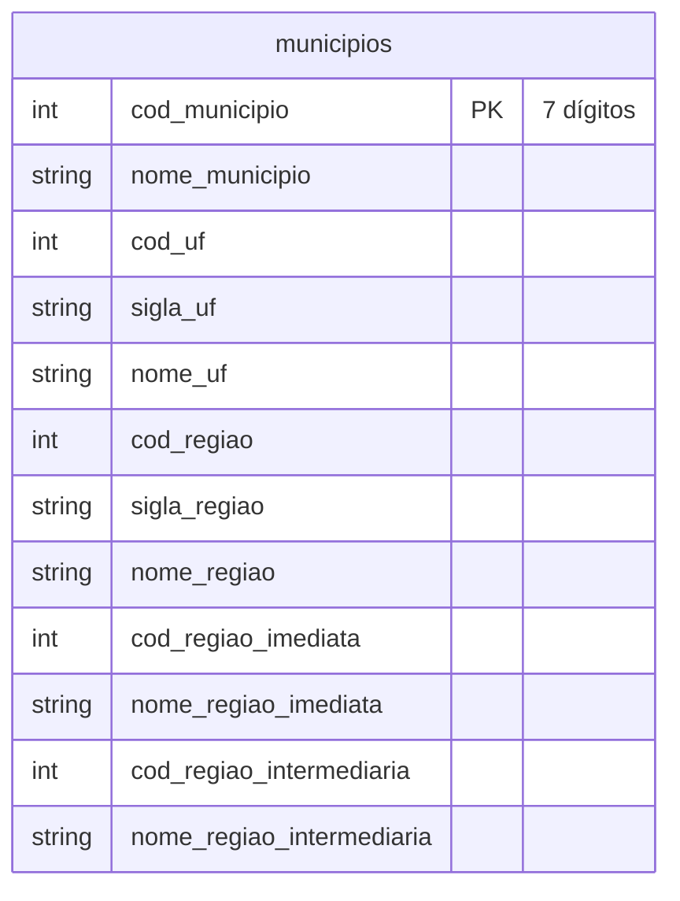
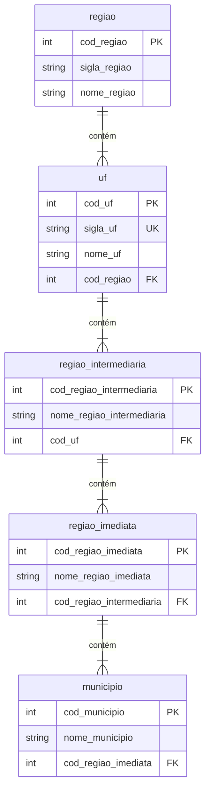

# IBGE: municípios, UFs e regiões

Dado público de referência, não é um sistema do grupo. É a lista oficial de municípios brasileiros com a hierarquia geográfica do IBGE. Todos os sistemas usam o código de município do IBGE nos endereços, nas rotas e nas lojas, então este arquivo é a dimensão geográfica comum a todas as bases.

| | |
|---|---|
| Schema na Bronze | `ibge` |
| Formato | CSV com cabeçalho, separador `,`, UTF-8 |
| Arquivo | um só, na carga inicial: `ibge/municipios/2025-12-31/municipios_20251231_0001.csv` |
| Entidade | `municipios` |
| Volume | 5.571 municípios, 27 UFs e 5 regiões, independentemente da escala |
| Artigos | 01, 08 e 10 |

O arquivo vem versionado no pacote do gerador (`src/modelbricks_gerador/dados/ibge_municipios.csv`), extraído da [API de Localidades do IBGE](https://servicodados.ibge.gov.br/api/docs/localidades) pelo script `scripts/extrair_ibge.py`. O setup não depende de rede. O `avancar_tempo` não gera arquivos novos do IBGE.

## Diagrama ER

O arquivo é uma única tabela desnormalizada. O primeiro diagrama mostra a tabela como ela chega. O segundo mostra a hierarquia que está embutida nela e que pode ser normalizada na Silver, por exemplo num Snowflake.

## Dicionário de dados

| Coluna | Tipo | Descrição |
|---|---|---|
| `cod_municipio` | int | Código do município no IBGE, 7 dígitos (o último é verificador). |
| `nome_municipio` | string | Nome do município, com acentos. |
| `cod_uf` | int | Código da UF, 2 dígitos. São os dois primeiros dígitos do `cod_municipio`. |
| `sigla_uf` | string | Sigla da UF (`ES`, `SP`...). |
| `nome_uf` | string | Nome da UF. |
| `cod_regiao` | int | Código da grande região, de 1 a 5. |
| `sigla_regiao` | string | `N`, `NE`, `SE`, `S` ou `CO`. |
| `nome_regiao` | string | Norte, Nordeste, Sudeste, Sul ou Centro-Oeste. |
| `cod_regiao_imediata` | int | Região geográfica imediata (6 dígitos), 510 no país. |
| `nome_regiao_imediata` | string | Nome da região imediata. |
| `cod_regiao_intermediaria` | int | Região geográfica intermediária (4 dígitos), 133 no país. |
| `nome_regiao_intermediaria` | string | Nome da região intermediária. |

## Uso nas outras bases

- O grupo atua em 10 UFs: ES, MG, RJ, SP, BA, GO, DF, PR, SC e RS (3.523 municípios). Rotas, bases, lojas, pessoas e empresas do mundo verdadeiro usam municípios dessas UFs. O arquivo traz o país inteiro.
- O defeito "município fora do padrão" (no *Pátio* e no *SolTicket*) produz códigos com 6 ou 8 dígitos, que não casam com este arquivo.
- O mundo verdadeiro também tem a tabela `municipios`, com o mesmo conteúdo, no `gabarito`.
