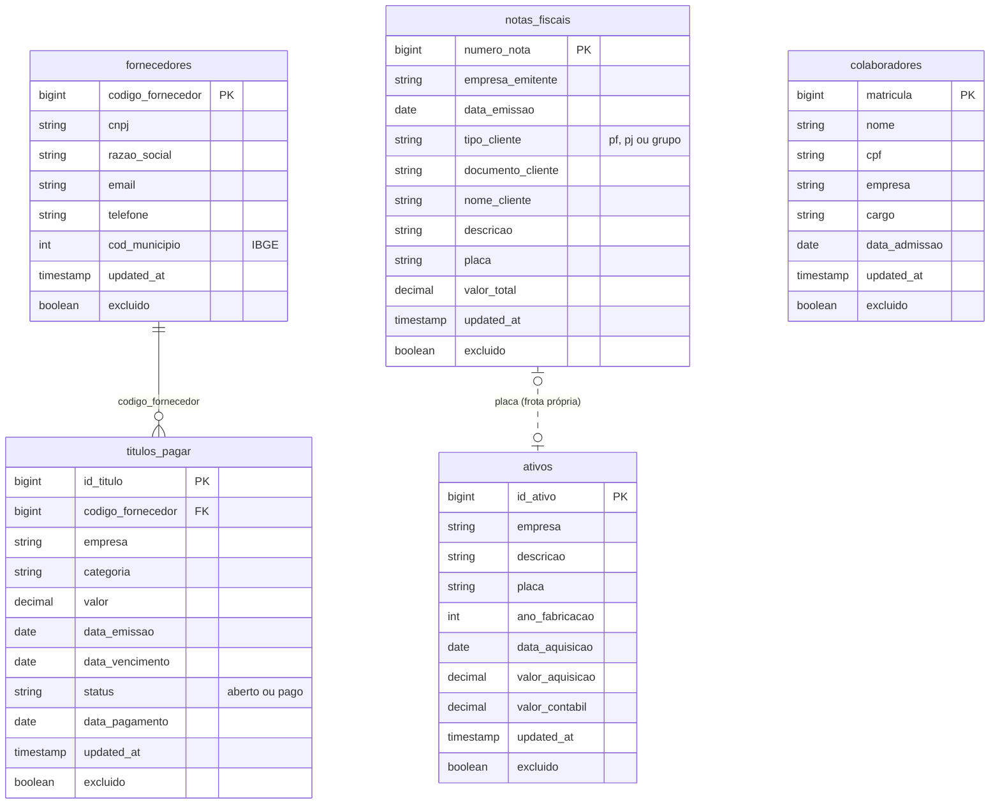

# *Núcleo*: ERP corporativo da holding

ERP do Grupo ModelBricks: financeiro, faturamento, fornecedores, colaboradores e ativos da holding, da Viação, da Cargas e da Veículos. Não tem log de mudanças. A extração é **incremental por `updated_at`**: cada lote diário traz as linhas alteradas no dia, com a imagem completa da linha. Exclusão é lógica (*soft delete*): o registro excluído chega como mais uma versão, com `excluido = true`.

| | |
|---|---|
| Schema na Bronze | `nucleo` |
| Formato | Parquet (tipos físicos preservados) |
| Arquivos | um por entidade e dia com mudanças: `nucleo/<entidade>/<AAAA-MM-DD>/<entidade>_<AAAAMMDD>_0001.parquet` |
| Entidades | `colaboradores`, `fornecedores`, `titulos_pagar`, `notas_fiscais`, `ativos` |
| Volume (escala 1) | 1.500 colaboradores, cerca de 300 fornecedores, 24 mil títulos a pagar e 3 mil notas fiscais em 2024 e 2025 |
| Fatias | 02, 03 e 10 |

## Diagrama ER

A linha pontilhada indica uma ligação que o ERP não declara: a nota fiscal de venda de um veículo da frota própria e o ativo correspondente têm a mesma `placa`.

## Colunas de controle

| Coluna | Tipo | Descrição |
|---|---|---|
| `updated_at` | timestamp | Instante da mudança. Uma chave nunca tem duas versões com o mesmo `updated_at`. |
| `excluido` | boolean | `true` na versão de exclusão lógica. Nada vem depois dela. |

**Implantação:** o *Núcleo* entrou em operação em 01/01/2024. O que já existia antes (colaboradores admitidos e fornecedores cadastrados) chega no lote desse dia, de madrugada (0h às 6h), como na carga de uma implantação. Depois disso, cada mudança chega no lote do dia em que aconteceu, no expediente (8h às 18h).

## Dicionário de dados

### `colaboradores`

Vínculo de uma pessoa do mundo verdadeiro com uma empresa do grupo.

| Coluna | Tipo | Descrição |
|---|---|---|
| `matricula` | bigint | Chave do sistema, com 7 dígitos. |
| `nome` | string | Nome completo. |
| `cpf` | string | CPF, 11 dígitos sem máscara. |
| `empresa` | string | `mb` (holding), `mb_viacao`, `mb_cargas` ou `mb_veiculos`. |
| `cargo` | string | Cargo atual (por exemplo, Motorista, Mecânico, Analista Financeiro, Vendedor). |
| `data_admissao` | date | Data de admissão, de 2005 a 2025. |

**Versões:** a entrada, com o cargo de admissão, e uma versão por **mudança de cargo** (cerca de 12% dos colaboradores por ano). O cargo novo é sempre diferente do anterior, então toda versão nova é uma mudança real de atributo.

### `fornecedores`

Parte das empresas PJ do mundo verdadeiro (20%) que fornecem ao grupo. 70% delas já estavam cadastradas na implantação; as demais são cadastradas ao longo de 2024 e 2025.

| Coluna | Tipo | Descrição |
|---|---|---|
| `codigo_fornecedor` | bigint | Chave do sistema, com 7 dígitos. |
| `cnpj` | string | CNPJ, 14 dígitos sem máscara. |
| `razao_social` | string | Razão social. |
| `email` | string | E-mail. |
| `telefone` | string | Telefone `(DD) 9NNNN-NNNN`. |
| `cod_municipio` | int | Município da sede (IBGE). |

**Versões:** o cadastro; trocas de telefone (cerca de 25% dos fornecedores por ano); e a exclusão lógica (cerca de 5% por ano), que encerra o fornecedor.

### `titulos_pagar`

Fato do sistema: contas a pagar do grupo. Cada título vai para um fornecedor ativo no dia da emissão.

| Coluna | Tipo | Descrição |
|---|---|---|
| `id_titulo` | bigint | Chave: `AAAAMMDD` da emissão seguido de um sequencial de 4 dígitos. |
| `codigo_fornecedor` | bigint | Fornecedor (FK para `fornecedores`). |
| `empresa` | string | Empresa devedora: `mb`, `mb_viacao`, `mb_cargas` ou `mb_veiculos`. |
| `categoria` | string | `combustivel`, `pecas`, `manutencao`, `servicos`, `aluguel` ou `outros`. |
| `valor` | decimal(12,2) | Valor, de R$ 300 a R$ 60 mil. |
| `data_emissao` | date | Dia da emissão. |
| `data_vencimento` | date | De 15 a 60 dias depois da emissão. |
| `status` | string | `aberto` ou `pago`. |
| `data_pagamento` | date | De 0 a 5 dias depois do vencimento; nula enquanto aberto. |

**Versões:** a emissão (`aberto`) e depois o pagamento (`pago`). Cerca de 3% dos títulos são cancelados antes do vencimento: a última versão continua `aberto`, com `excluido = true`.

### `notas_fiscais`

Faturamento da ModelBricks Veículos: uma nota por venda de veículo do mundo verdadeiro. Tem uma única versão, a emissão.

| Coluna | Tipo | Descrição |
|---|---|---|
| `numero_nota` | bigint | Chave do sistema, com 8 dígitos. |
| `empresa_emitente` | string | Sempre `mb_veiculos`. |
| `data_emissao` | date | Dia da venda. |
| `tipo_cliente` | string | `pf`, `pj` ou `grupo` (venda para a Viação ou a Cargas). |
| `documento_cliente` | string | CPF ou CNPJ do comprador; nulo nas vendas para o grupo. |
| `nome_cliente` | string | Nome, razão social ou, nas vendas para o grupo, o código da empresa (`mb_viacao` ou `mb_cargas`). |
| `descricao` | string | `Ônibus` ou `Caminhão`, marca e modelo. |
| `placa` | string | Placa do veículo vendido. |
| `valor_total` | decimal(14,2) | Valor da venda, em R$. |

### `ativos`

Veículos da frota própria, registrados como ativo imobilizado da empresa que os comprou.

| Coluna | Tipo | Descrição |
|---|---|---|
| `id_ativo` | bigint | Chave do sistema, com 7 dígitos. |
| `empresa` | string | `mb_viacao` (ônibus) ou `mb_cargas` (caminhões). |
| `descricao` | string | Tipo, marca e modelo. |
| `placa` | string | Placa do veículo. |
| `ano_fabricacao` | int | Ano de fabricação. |
| `data_aquisicao` | date | Dia da compra na ModelBricks Veículos. |
| `valor_aquisicao` | decimal(14,2) | Valor da nota de compra. |
| `valor_contabil` | decimal(14,2) | Valor depreciado (10% ao ano, linear), nunca negativo. |

**Versões:** a aquisição e, no último dia de cada mês seguinte, uma versão com o `valor_contabil` depreciado.

## Ligação com o mundo verdadeiro

Em `gabarito.mapa_chaves` (fatias com gabarito):

| Entidade | Coluna | Tabela verdadeira |
|---|---|---|
| `colaboradores` | `matricula` | `colaboradores` |
| `fornecedores` | `codigo_fornecedor` | `empresas_pj` |
| `notas_fiscais` | `numero_nota` | `vendas_veiculos` |
| `ativos` | `id_ativo` | `veiculos` |

## Defeitos

O roteiro não aplica defeitos ao *Núcleo*: os arquivos chegam limpos em todas as fatias. O código do gerador sabe aplicar CPF fora do padrão e nome abreviado aos colaboradores, contato nulo aos fornecedores e evento atrasado a todas as entidades, caso o roteiro passe a dar taxa a eles.
