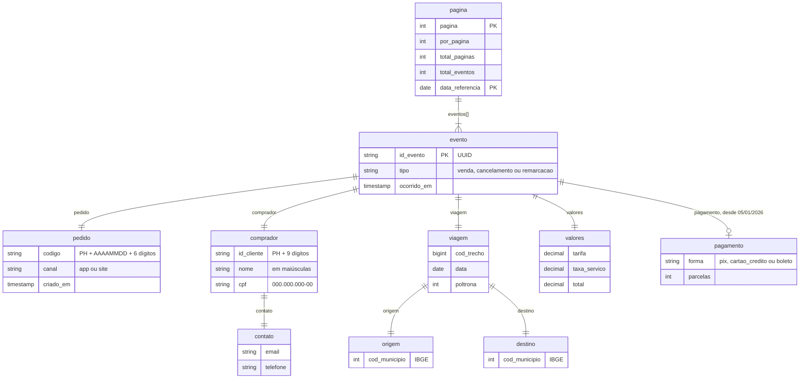

# *PassagemHub*: marketplace parceiro da Viação

Marketplace que vende passagens das linhas da ModelBricks Viação pelo app e pelo site. O grupo consome a **API paginada** do parceiro: cada página traz os eventos de venda de um dia, em JSON aninhado. O *PassagemHub* vende para os mesmos clientes do *Embarque*, mas com chave e grafia próprias.

| | |
|---|---|
| Schema na Bronze | `passagemhub` |
| Formato | JSON aninhado, um documento por arquivo (em uma linha) |
| Arquivos | uma página por arquivo: `passagemhub/eventos_venda/<AAAA-MM-DD>/eventos_venda_<AAAAMMDD>_<página>.json` |
| Entidade | `eventos_venda` |
| Volume (escala 1) | cerca de 240 mil pedidos em 2024 e 2025 (40% das vendas da Viação) |
| Fatias | 01, 04, 05, 06, 07 e 10 |

## Diagrama ER

O arquivo é um único documento: a página, com a lista de eventos. Cada objeto aninhado aparece no diagrama como uma entidade, ligada ao objeto que a contém.



Exemplo de evento (dentro de `eventos`), a partir de 05/01/2026:

```json
{
  "id_evento": "3f2a9c1e-5b7d-4e08-9a61-0c4d8e2f7b13",
  "tipo": "venda",
  "ocorrido_em": "2026-01-07T14:32:05.000Z",
  "pedido": {"codigo": "PH20260107000123", "canal": "app", "criado_em": "2026-01-07T14:32:05.000Z"},
  "comprador": {
    "id_cliente": "PH123456789", "nome": "MARIA SOUZA LIMA", "cpf": "123.456.789-09",
    "contato": {"email": "maria.lima42@gmail.com", "telefone": "(27) 91234-5678"}
  },
  "viagem": {"cod_trecho": 1234567, "origem": {"cod_municipio": 3205309}, "destino": {"cod_municipio": 3304557}, "data": "2026-01-20", "poltrona": 12},
  "valores": {"tarifa": 168.30, "taxa_servico": 13.46, "total": 181.76},
  "pagamento": {"forma": "cartao_credito", "parcelas": 3}
}
```

Os valores do exemplo são ilustrativos.

## Dicionário de dados

### Página (raiz do documento)

| Campo | Tipo | Descrição |
|---|---|---|
| `pagina` | int | Número da página no dia, a partir de 1. |
| `por_pagina` | int | Tamanho da página: 100 eventos. |
| `total_paginas` | int | Total de páginas do dia. |
| `total_eventos` | int | Total de eventos do dia. |
| `data_referencia` | date | Dia dos eventos da página. |
| `eventos` | array | Eventos da página, em ordem de `ocorrido_em`. |

### Evento

| Campo | Tipo | Descrição |
|---|---|---|
| `id_evento` | string | UUID do evento, único. |
| `tipo` | string | `venda`, `cancelamento` ou `remarcacao`. |
| `ocorrido_em` | timestamp | Instante do evento. |
| `pedido.codigo` | string | Código do pedido: `PH`, `AAAAMMDD` da compra e 6 dígitos. Liga os eventos de um mesmo pedido. |
| `pedido.canal` | string | `app` ou `site`. |
| `pedido.criado_em` | timestamp | Instante da compra. |
| `comprador.id_cliente` | string | Chave do cliente no marketplace: `PH` seguido de 9 dígitos. |
| `comprador.nome` | string | Nome em maiúsculas. |
| `comprador.cpf` | string | CPF com máscara `000.000.000-00`. |
| `comprador.contato.email` | string | E-mail. |
| `comprador.contato.telefone` | string | Telefone `(DD) 9NNNN-NNNN`. |
| `viagem.cod_trecho` | bigint | Código do trecho no marketplace (7 dígitos). Equivale a uma linha da Viação, com outra chave. |
| `viagem.origem.cod_municipio` | int | Município de origem (IBGE). |
| `viagem.destino.cod_municipio` | int | Município de destino (IBGE). |
| `viagem.data` | date | Data da viagem: 0 a 45 dias depois da compra, ou a nova data na remarcação. |
| `viagem.poltrona` | int | Poltrona, de 1 a 46. |
| `valores.tarifa` | decimal(10,2) | Tarifa da Viação vigente na compra, com o mesmo reajuste de 12/01/2026 do *Embarque*. |
| `valores.taxa_servico` | decimal(10,2) | Taxa do marketplace: 8% da tarifa. |
| `valores.total` | decimal(10,2) | Tarifa mais taxa. |
| `pagamento.forma` | string | `pix`, `cartao_credito` ou `boleto`. |
| `pagamento.parcelas` | int | De 1 a 6 no cartão; 1 nas demais formas. |

### Eventos de um pedido

Os eventos são imutáveis. Uma mudança no pedido chega como um evento novo, com a imagem completa do pedido:

| `tipo` | Quando acontece | Frequência |
|---|---|---|
| `venda` | Na compra. | Todo pedido. |
| `cancelamento` | Entre a compra e a 0h do dia da viagem. | 6% dos pedidos. |
| `remarcacao` | Idem, com `viagem.data` adiada de 1 a 15 dias. | 3% dos pedidos. |

- Pedido com viagem para o mesmo dia da compra nunca é cancelado nem remarcado.
- O marketplace não informa a utilização da passagem nem estornos.

### Evolução do schema

A partir de **05/01/2026**, todo evento traz o objeto `pagamento`. Antes dessa data, nenhum evento o traz: o campo não existe no JSON (não chega como nulo). É um caso típico de *schema evolution*: o schema inferido muda no meio da história.

## Ligação com o mundo verdadeiro

Em `gabarito.mapa_chaves` (fatias com gabarito):

| Entidade | Coluna | Tabela verdadeira |
|---|---|---|
| `eventos_venda` | `id_cliente` | `pessoas` |
| `eventos_venda` | `cod_trecho` | `rotas` |

## Defeitos

Os defeitos são sorteados **por pedido**: todos os eventos de um pedido sujo saem com a mesma sujeira. O registro em `gabarito.defeitos` traz o arquivo da página.

| Defeito | Taxa | Como aparece |
|---|---|---|
| Nome abreviado ou com erro | 10% dos pedidos | `comprador.nome` sem acentos, com o nome do meio abreviado ou com uma letra omitida. |
| Contato nulo | 15% dos pedidos | `comprador.contato.email` ou `telefone` nulo. |
