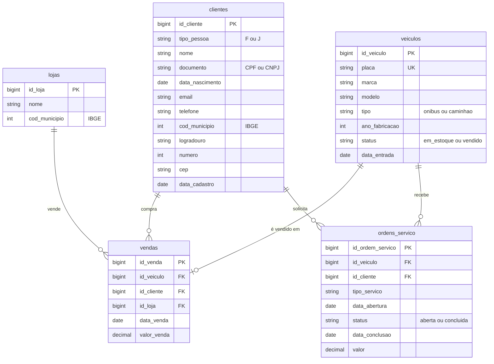

# *Pátio*: DMS da ModelBricks Veículos

Sistema de gestão da concessionária de ônibus e caminhões (DMS): estoque, venda de veículos e oficina. Não tem log de mudanças nem coluna de atualização. O grupo recebe **fotos completas** das tabelas: cada arquivo é a tabela inteira como estava no fim do dia da foto.

| | |
|---|---|
| Schema na Bronze | `patio` |
| Formato | CSV com cabeçalho, separador `,`, UTF-8 |
| Arquivos | um por entidade e data de foto: `patio/<entidade>/<AAAA-MM-DD>/<entidade>_<AAAAMMDD>_0001.csv` |
| Entidades | `lojas`, `clientes`, `veiculos`, `vendas`, `ordens_servico` |
| Volume (escala 1) | 3 mil vendas de veículos e cerca de 12 mil ordens de serviço em 2024 e 2025 |
| Artigos | 01, 02, 03, 08 e 10 |

## Diagrama ER

## Agenda das fotos

| Período | Frequência |
|---|---|
| 01/01/2024 a 30/11/2025 | mensal, no último dia do mês |
| a partir de 01/12/2025 (inclusive no `avancar_tempo`) | diária |

- Toda entidade tem arquivo em toda data de foto, mesmo que vazio (só o cabeçalho).
- As linhas vêm em ordem da chave.
- Datas saem como `AAAA-MM-DD`, nulos como campo vazio e textos vazios como `""`.
- Como não há coluna de controle, a mudança só é percebida comparando uma foto com a anterior. Uma mudança que acontece e é desfeita entre duas fotos nunca aparece.
- **A exclusão é a ausência:** o registro excluído some da foto seguinte.

## Dicionário de dados

### `lojas`

Lojas da concessionária. Não mudam.

| Coluna | Tipo | Descrição |
|---|---|---|
| `id_loja` | bigint | Chave do sistema, com 5 dígitos. |
| `nome` | string | `ModelBricks Veículos <Município>/<UF>`. |
| `cod_municipio` | int | Município da loja (IBGE). |

### `clientes`

Clientes pessoa física e jurídica da concessionária e as duas empresas do grupo que compram a frota própria (ModelBricks Viação S.A. e ModelBricks Cargas S.A.).

| Coluna | Tipo | Descrição |
|---|---|---|
| `id_cliente` | bigint | Chave do sistema, com 9 dígitos. |
| `tipo_pessoa` | string | `F` (pessoa física) ou `J` (pessoa jurídica). |
| `nome` | string | Nome da pessoa ou razão social. |
| `documento` | string | CPF (11 dígitos) ou CNPJ (14 dígitos), sem máscara. |
| `data_nascimento` | date | Só para pessoa física. |
| `email` | string | E-mail. |
| `telefone` | string | Telefone `(DD) 9NNNN-NNNN`. |
| `cod_municipio` | int | Município do endereço (IBGE). |
| `logradouro` | string | Rua. |
| `numero` | int | Número do endereço. |
| `cep` | string | CEP `NNNNN-NNN`. |
| `data_cadastro` | date | Dia em que passou a ser cliente ou, se antes, dia da primeira compra. |

**Mudanças:** depois do cadastro, cada cliente pode ter até 6 atualizações, de telefone (40%), e-mail (30%) ou endereço (30%), espaçadas de 120 a 900 dias. As atualizações são do DMS: o cadastro verdadeiro no `gabarito` não muda, porque o DMS guarda a versão que o cliente informou depois. As empresas do grupo não mudam.

### `veiculos`

Ônibus e caminhões que passaram pelo pátio da concessionária, inclusive a frota própria do grupo.

| Coluna | Tipo | Descrição |
|---|---|---|
| `id_veiculo` | bigint | Chave do sistema, com 8 dígitos. |
| `placa` | string | Placa no padrão Mercosul (`LLLNLNN`), sem hífen. |
| `marca` | string | Fabricante (Mercedes-Benz, Volvo, Scania, Volkswagen, Iveco, DAF). |
| `modelo` | string | Modelo. |
| `tipo` | string | `onibus` ou `caminhao`. |
| `ano_fabricacao` | int | De 2012 a 2025. |
| `status` | string | `em_estoque` ao entrar no pátio; `vendido` na venda. |
| `data_entrada` | date | Entrada no pátio, de 10 a 120 dias antes da venda (nunca antes de 01/01/2024). |

### `vendas`

Uma venda por veículo, vinda do mundo verdadeiro. Não muda depois de registrada.

| Coluna | Tipo | Descrição |
|---|---|---|
| `id_venda` | bigint | Chave do sistema, com 8 dígitos. |
| `id_veiculo` | bigint | Veículo vendido (FK para `veiculos`). |
| `id_cliente` | bigint | Comprador (FK para `clientes`). |
| `id_loja` | bigint | Loja da venda (FK para `lojas`). |
| `data_venda` | date | Dia da venda. |
| `valor_venda` | decimal(14,2) | Valor, em R$, dentro da faixa de preço do modelo. |

### `ordens_servico`

Fato do sistema: atendimentos da oficina a veículos já vendidos.

| Coluna | Tipo | Descrição |
|---|---|---|
| `id_ordem_servico` | bigint | Chave: `AAAAMMDD` da abertura seguido de um sequencial de 4 dígitos. |
| `id_veiculo` | bigint | Veículo atendido (FK para `veiculos`). |
| `id_cliente` | bigint | Dono do veículo (FK para `clientes`). |
| `tipo_servico` | string | Revisão, Troca de óleo, Freios, Suspensão, Elétrica, Pneus, Motor ou Funilaria. |
| `data_abertura` | date | Dia da abertura. |
| `status` | string | `aberta` ou `concluida`. |
| `data_conclusao` | date | Preenchida na conclusão, de 0 a 7 dias depois da abertura. |
| `valor` | decimal(12,2) | Valor do serviço, em R$, preenchido na conclusão. |

Cerca de 3% das ordens são canceladas. A ordem cancelada é **excluída** do DMS e some da foto seguinte.

## Ligação com o mundo verdadeiro

Em `gabarito.mapa_chaves`:

| Entidade | Coluna | Tabela verdadeira |
|---|---|---|
| `clientes` | `id_cliente` | `pessoas` (PF) ou `empresas_pj` (PJ) |
| `veiculos` | `id_veiculo` | `veiculos` |
| `vendas` | `id_venda` | `vendas_veiculos` |
| `lojas` | `id_loja` | `lojas` |

As duas empresas do grupo cadastradas como clientes não têm linha no mapa: elas não são `empresas_pj` do mundo verdadeiro.

## Defeitos

Os defeitos são sorteados pela chave do cliente, então acompanham o cliente em todas as versões do cadastro. Cada versão suja é registrada uma vez, na primeira foto que a contém.

| Defeito | Taxa | Como aparece |
|---|---|---|
| Contato nulo | 15% dos clientes | `email` ou `telefone` vazio. |
| Município fora do padrão | 2% dos clientes | `cod_municipio` com 6 dígitos (sem o dígito verificador) ou com 8 dígitos (zero à esquerda). |
