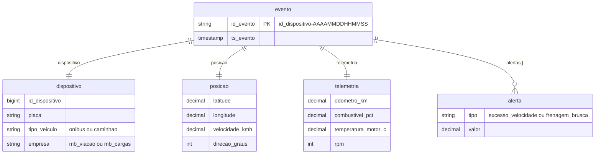

# *Rastro*: telemetria da frota própria

Plataforma de rastreamento dos ônibus da ModelBricks Viação e dos caminhões da ModelBricks Cargas. Cada veículo da frota própria emite um evento de GPS e telemetria a cada 15 minutos de operação. A entrega simula um **stream** em arquivos: muitos arquivos pequenos por dia, sem Kafka.

| | |
|---|---|
| Schema na Bronze | `rastro` |
| Formato | JSON lines aninhado (um evento por linha) |
| Arquivos | até 24 por dia, um por hora de chegada com eventos: `rastro/eventos/<AAAA-MM-DD>/eventos_<AAAAMMDD>_<NNNN>.json`, com `NNNN` de `0001` a `0024` |
| Entidade | `eventos` |
| Volume (escala 1) | 400 veículos × 72 eventos por dia; cerca de 2,6 milhões de eventos nos 90 dias da carga inicial |
| Artigos | 01, 09 e 10 |

## Diagrama ER

Cada linha é um documento JSON. Os objetos aninhados aparecem no diagrama como entidades ligadas ao evento.



Exemplo de linha (valores ilustrativos):

```json
{"id_evento": "1234567-20251215081502", "ts_evento": "2025-12-15T08:15:02.000Z",
 "dispositivo": {"id_dispositivo": 1234567, "placa": "RKT4F27", "tipo_veiculo": "onibus", "empresa": "mb_viacao"},
 "posicao": {"latitude": -20.315412, "longitude": -40.312876, "velocidade_kmh": 94.3, "direcao_graus": 212},
 "telemetria": {"odometro_km": 152340.5, "combustivel_pct": 88.2, "temperatura_motor_c": 91.7, "rpm": 1480},
 "alertas": [{"tipo": "excesso_velocidade", "valor": 94.3}]}
```

## Dicionário de dados

| Campo | Tipo | Descrição |
|---|---|---|
| `id_evento` | string | `id_dispositivo`, hífen e o instante do evento (`AAAAMMDDHHMMSS`). Único. |
| `ts_evento` | timestamp | Instante do evento: a cada 15 minutos, entre 05h e 23h, com até 60 segundos de variação. |
| `dispositivo.id_dispositivo` | bigint | Chave do veículo no *Rastro*, com 7 dígitos. |
| `dispositivo.placa` | string | Placa do veículo. É o ponto de conformação com o *Pátio* e o *RotaCerta*. |
| `dispositivo.tipo_veiculo` | string | `onibus` ou `caminhao`. |
| `dispositivo.empresa` | string | Dona do veículo: `mb_viacao` (ônibus) ou `mb_cargas` (caminhões). |
| `posicao.latitude` | decimal(9,6) | Latitude. O veículo percorre uma reta entre dois pontos sorteados por dia, dentro da área de atuação do grupo. |
| `posicao.longitude` | decimal(9,6) | Longitude. |
| `posicao.velocidade_kmh` | decimal(5,1) | Velocidade, de 0 a 110 km/h. |
| `posicao.direcao_graus` | int | Direção do deslocamento, de 0 a 359 graus. |
| `telemetria.odometro_km` | decimal(10,1) | Quilometragem acumulada desde o início da operação (300 a 700 km por dia). |
| `telemetria.combustivel_pct` | decimal(4,1) | Nível do tanque: começa o dia em 100% e cai de 35 a 70 pontos até o fim da operação. |
| `telemetria.temperatura_motor_c` | decimal(4,1) | Temperatura do motor, de 80 °C a 105 °C. |
| `telemetria.rpm` | int | Rotação do motor, de 600 a 2.200 rpm. |
| `alertas` | array | Lista de alertas do evento; vazia na maioria dos eventos. |
| `alertas[].tipo` | string | `excesso_velocidade` (velocidade acima de 90 km/h) ou `frenagem_brusca` (1% dos eventos). |
| `alertas[].valor` | decimal(5,1) | Velocidade no momento do alerta. |

## Regras de entrega

- Só os veículos da **frota própria** emitem eventos, a partir do dia seguinte à compra do veículo na ModelBricks Veículos.
- **Carga inicial:** traz só os últimos 90 dias até 31/12/2025, seja qual for a escala. A telemetria é o maior volume do grupo, e a janela fixa mantém a carga viável no Free Edition.
- **Arquivos:** o dia é dividido em 24 janelas de uma hora. Cada janela com eventos vira um arquivo, com as linhas na ordem de chegada. As horas sem operação (23h às 5h) não têm arquivo, salvo eventos atrasados.
- No `avancar_tempo`, cada dia novo chega com os seus arquivos.

## Ligação com o mundo verdadeiro

Em `gabarito.mapa_chaves`:

| Entidade | Coluna | Tabela verdadeira |
|---|---|---|
| `eventos` | `id_dispositivo` | `veiculos` |

## Defeitos

| Defeito | Taxa | Como aparece |
|---|---|---|
| Evento atrasado | 2% dos eventos | O evento chega de 1 a 3 dias depois de `ts_evento`, num arquivo de um dia posterior (*late-arriving data*). |
