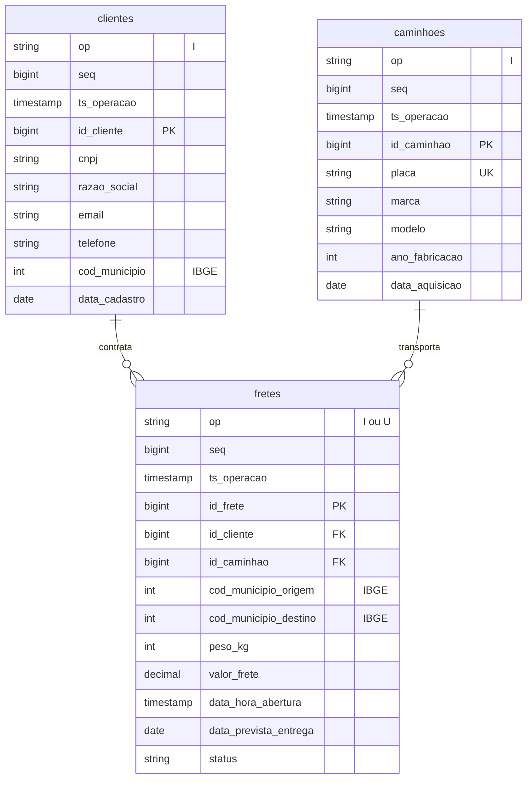
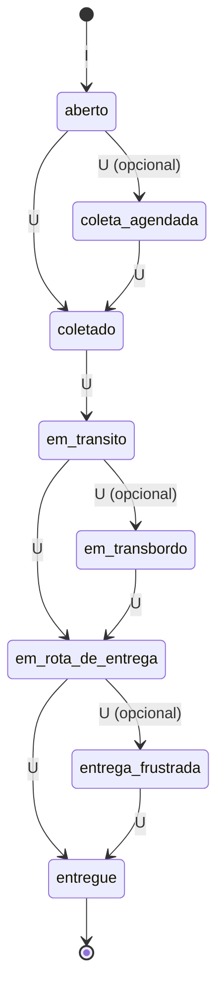

# *RotaCerta*: TMS da ModelBricks Cargas

Sistema de gestão de transporte (TMS) da ModelBricks Cargas: clientes, caminhões e ordens de frete, da coleta à entrega. Entrega um **log de CDC** no mesmo formato do [*Embarque*](embarque.md). O destaque é o ciclo de vida do frete, com várias mudanças de status ao longo de dias.

| | |
|---|---|
| Schema na Bronze | `rotacerta` |
| Formato | JSON lines (um objeto JSON por linha) |
| Arquivos | um por entidade e dia simulado: `rotacerta/<entidade>/<AAAA-MM-DD>/<entidade>_<AAAAMMDD>_0001.json` |
| Entidades | `clientes`, `caminhoes`, `fretes` |
| Volume (escala 1) | 60 mil fretes em 2024 e 2025, com 5 a 8 operações cada |
| Fatias | 02, 04, 09 e 10 |

## Diagrama ER

As colunas de controle `op`, `seq` e `ts_operacao` seguem as mesmas regras do [*Embarque*](embarque.md#envelope-de-cdc). O *RotaCerta* não tem exclusões: só `I` e `U`.

## Dicionário de dados

### `clientes`

Empresas PJ do mundo verdadeiro clientes da Cargas. Um único `I`, de madrugada, no dia em que a empresa se tornou cliente.

| Coluna | Tipo | Descrição |
|---|---|---|
| `id_cliente` | bigint | Chave do sistema, com 7 dígitos. |
| `cnpj` | string | CNPJ, 14 dígitos sem máscara. |
| `razao_social` | string | Razão social. |
| `email` | string | E-mail. |
| `telefone` | string | Telefone `(DD) 9NNNN-NNNN`. |
| `cod_municipio` | int | Município da sede (IBGE). É a origem dos fretes do cliente. |
| `data_cadastro` | date | Dia em que a empresa se tornou cliente. |

### `caminhoes`

Caminhões da frota própria da Cargas, comprados na ModelBricks Veículos. Um único `I`, de madrugada, no dia da aquisição.

| Coluna | Tipo | Descrição |
|---|---|---|
| `id_caminhao` | bigint | Chave do sistema, com 6 dígitos. |
| `placa` | string | Placa do caminhão. É o ponto de conformação com o *Pátio* e o *Rastro*. |
| `marca` | string | Fabricante. |
| `modelo` | string | Modelo. |
| `ano_fabricacao` | int | Ano de fabricação. |
| `data_aquisicao` | date | Dia da compra. |

### `fretes`

Fato do sistema: ordens de frete. Cada mudança de status é um `U` com a imagem completa da linha; só o `status` muda.

| Coluna | Tipo | Descrição |
|---|---|---|
| `id_frete` | bigint | Chave: `AAAAMMDD` da abertura seguido de um sequencial de 5 dígitos. |
| `id_cliente` | bigint | Cliente do frete (FK para `clientes`). |
| `id_caminhao` | bigint | Caminhão alocado (FK para `caminhoes`). |
| `cod_municipio_origem` | int | Município do cliente (IBGE). |
| `cod_municipio_destino` | int | Município de destino nas UFs de atuação do grupo, sempre diferente da origem. |
| `peso_kg` | int | Peso da carga, de 300 a 28.000 kg. |
| `valor_frete` | decimal(12,2) | R$ 0,42 por kg. |
| `data_hora_abertura` | timestamp | Instante da abertura, entre 06h e 22h. |
| `data_prevista_entrega` | date | De 4 a 15 dias depois da abertura. |
| `status` | string | Etapa atual do ciclo (abaixo). |

**Ciclo de vida de um frete:**

- Cada frete tem de 5 a 8 operações, a abertura inclusive. As 5 etapas obrigatórias sempre acontecem, e as opcionais sorteadas completam a quantidade.
- Cada mudança cai num dia diferente, de 1 a 3 dias depois da anterior, entre 06h e 22h.
- O histórico completo do frete permite montar um *accumulating snapshot*, com uma data por etapa.

## Ligação com o mundo verdadeiro

Em `gabarito.mapa_chaves` (fatias com gabarito):

| Entidade | Coluna | Tabela verdadeira |
|---|---|---|
| `clientes` | `id_cliente` | `empresas_pj` |
| `caminhoes` | `id_caminhao` | `veiculos` |

## Defeitos

| Defeito | Taxa | Como aparece |
|---|---|---|
| Evento atrasado | 2% das operações de `fretes` | A mudança de status chega de 1 a 3 dias depois, com `seq` maior que a de mudanças posteriores do mesmo frete (*late-arriving data*). Ordenar por `seq` coloca o status fora de ordem; ordenar por `ts_operacao` corrige. |

O código do gerador também sabe aplicar contato nulo aos `clientes` e CDC duplicado aos `fretes`, mas o roteiro não liga esses defeitos para este sistema.
