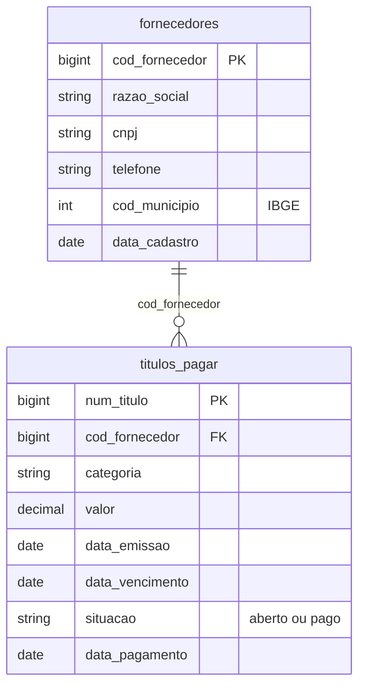

# *SolFin*: ERP legado do Expresso Vale do Sol

Financeiro próprio do Expresso Vale do Sol, ainda não migrado para o [*Núcleo*](nucleo.md) depois da aquisição. Segue o mesmo padrão de entrega do [*SolTicket*](solticket.md): nada antes de 01/07/2025, a **carga histórica inteira** no dia da aquisição e uma **foto completa por semana** depois, em CSV `;` com encoding `latin1`.

| | |
|---|---|
| Schema na Bronze | `solfin` |
| Formato | CSV com cabeçalho, separador `;`, encoding `latin1` (ISO-8859-1) |
| Arquivos | um por entidade e data de foto: `solfin/<entidade>/<AAAA-MM-DD>/<entidade>_<AAAAMMDD>_0001.csv` |
| Entidades | `fornecedores`, `titulos_pagar` |
| Volume (escala 1) | cerca de 45 fornecedores e 5 mil títulos na carga histórica (01/01/2024 a 30/06/2025), no mesmo ritmo depois |
| Fatias | 05, 06 e 10 |

## Diagrama ER

A agenda das fotos é a mesma do [*SolTicket*](solticket.md#agenda-das-fotos).

## Dicionário de dados

### `fornecedores`

Empresas PJ do mundo verdadeiro que fornecem ao Vale do Sol (3% delas). Uma mesma empresa pode ser também fornecedora no *Núcleo* ou cliente de outra empresa do grupo, com outra chave. Todas já estavam cadastradas no início da história e não mudam.

| Coluna | Tipo | Descrição |
|---|---|---|
| `cod_fornecedor` | bigint | Chave do sistema, com 6 dígitos. |
| `razao_social` | string | Razão social, com acentos. |
| `cnpj` | string | CNPJ, 14 dígitos sem máscara. |
| `telefone` | string | Telefone `(DD) 9NNNN-NNNN`. |
| `cod_municipio` | int | Município da sede (IBGE). |
| `data_cadastro` | date | Sempre 01/01/2024. |

### `titulos_pagar`

Fato do sistema: contas a pagar do Vale do Sol.

| Coluna | Tipo | Descrição |
|---|---|---|
| `num_titulo` | bigint | Chave: `AAAAMMDD` da emissão seguido de um sequencial de 4 dígitos. |
| `cod_fornecedor` | bigint | Fornecedor (FK para `fornecedores`). |
| `categoria` | string | `Combustível`, `Manutenção`, `Peças`, `Pedágio`, `Serviços` ou `Aluguel`, com acentos. |
| `valor` | decimal(12,2) | De R$ 200 a R$ 40 mil. |
| `data_emissao` | date | Dia da emissão. |
| `data_vencimento` | date | De 10 a 45 dias depois da emissão. |
| `situacao` | string | `aberto` na emissão; `pago` no pagamento. |
| `data_pagamento` | date | De 0 a 10 dias depois do vencimento; vazia enquanto aberto. |

As categorias do *SolFin* são diferentes das do *Núcleo* (`combustivel`, `pecas`...): grafia, acentos e lista de valores não coincidem, como costuma acontecer entre o ERP de uma empresa adquirida e o da adquirente.

## Ligação com o mundo verdadeiro

Em `gabarito.mapa_chaves` (fatias com gabarito):

| Entidade | Coluna | Tabela verdadeira |
|---|---|---|
| `fornecedores` | `cod_fornecedor` | `empresas_pj` |

## Defeitos

| Defeito | Taxa | Como aparece |
|---|---|---|
| `latin1` | todos os arquivos | As categorias e as razões sociais têm acento, então os arquivos não são UTF-8 válido. Registrado uma vez por arquivo. |
