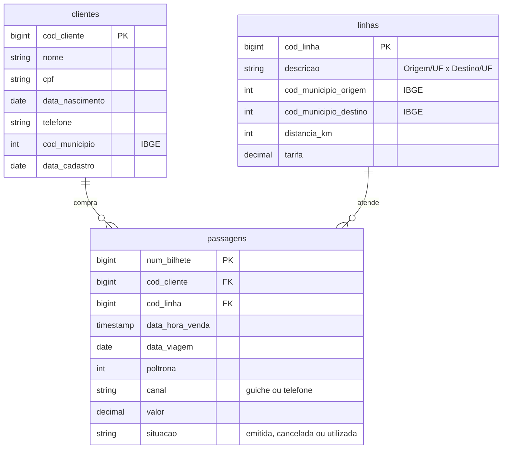

# *SolTicket*: bilhetagem legada do Expresso Vale do Sol

Sistema de venda de passagens do Expresso Vale do Sol, empresa de ônibus adquirida pelo Grupo ModelBricks em **01/07/2025**. É um legado: não tem API nem CDC. No dia da aquisição o grupo recebeu a **carga histórica inteira** e, desde então, recebe uma **foto completa por semana**, em CSV com separador `;` e encoding `latin1`.

| | |
|---|---|
| Schema na Bronze | `solticket` |
| Formato | CSV com cabeçalho, separador `;`, encoding `latin1` (ISO-8859-1) |
| Arquivos | um por entidade e data de foto: `solticket/<entidade>/<AAAA-MM-DD>/<entidade>_<AAAAMMDD>_0001.csv` |
| Entidades | `clientes`, `linhas`, `passagens` |
| Volume (escala 1) | 150 mil passagens na carga histórica (01/01/2024 a 30/06/2025), no mesmo ritmo depois |
| Fatias | 05, 06 e 10 |

## Diagrama ER

## Agenda das fotos

| Data | Conteúdo |
|---|---|
| antes de 01/07/2025 | nada: o sistema ainda não pertence ao grupo |
| 01/07/2025 | carga histórica: a foto completa de tudo desde 01/01/2024 |
| toda segunda-feira depois disso (inclusive no `avancar_tempo`) | foto completa da semana |

As fotos seguem as mesmas regras das do [*Pátio*](patio.md#agenda-das-fotos): toda entidade tem arquivo em toda data, mesmo vazio, e a mudança só é percebida comparando fotos.

## Dicionário de dados

### `clientes`

Pessoas clientes do Expresso Vale do Sol no mundo verdadeiro. As que também são clientes da ModelBricks Viação aparecem aqui com outra chave e, muitas vezes, outra grafia. A sobreposição com o *Embarque* só se confirma pelo `gabarito.mapa_chaves`.

| Coluna | Tipo | Descrição |
|---|---|---|
| `cod_cliente` | bigint | Chave do sistema, com 9 dígitos. |
| `nome` | string | Nome completo, com acentos. |
| `cpf` | string | CPF, 11 dígitos sem máscara. |
| `data_nascimento` | date | Data de nascimento. |
| `telefone` | string | Telefone `(DD) 9NNNN-NNNN`. O legado não guarda e-mail. |
| `cod_municipio` | int | Município de residência (IBGE). |
| `data_cadastro` | date | Dia em que a pessoa se tornou cliente. |

### `linhas`

Linhas de ônibus do Expresso Vale do Sol. Não mudam.

| Coluna | Tipo | Descrição |
|---|---|---|
| `cod_linha` | bigint | Chave do sistema, com 6 dígitos. |
| `descricao` | string | `Município/UF x Município/UF`. |
| `cod_municipio_origem` | int | Município de origem (IBGE). |
| `cod_municipio_destino` | int | Município de destino (IBGE). |
| `distancia_km` | int | Distância, de 60 a 1.200 km. |
| `tarifa` | decimal(10,2) | Tarifa da linha, em R$. |

### `passagens`

Fato do sistema: passagens vendidas no guichê e por telefone.

| Coluna | Tipo | Descrição |
|---|---|---|
| `num_bilhete` | bigint | Chave: `AAAAMMDD` da venda seguido de um sequencial de 5 dígitos. |
| `cod_cliente` | bigint | Cliente (FK para `clientes`). |
| `cod_linha` | bigint | Linha (FK para `linhas`). |
| `data_hora_venda` | timestamp | Instante da venda, entre 06h e 22h. |
| `data_viagem` | date | De 0 a 20 dias depois da venda. |
| `poltrona` | int | Poltrona, de 1 a 42. |
| `canal` | string | `guiche` ou `telefone`. |
| `valor` | decimal(10,2) | Tarifa da linha. |
| `situacao` | string | `emitida` na venda; depois `cancelada` (5%, antes da viagem) ou `utilizada` (no fim do dia da viagem). |

## Ligação com o mundo verdadeiro

Em `gabarito.mapa_chaves` (fatias com gabarito):

| Entidade | Coluna | Tabela verdadeira |
|---|---|---|
| `clientes` | `cod_cliente` | `pessoas`, inclusive as cópias duplicadas, com o id da pessoa original |
| `linhas` | `cod_linha` | `rotas` |

## Defeitos

O *SolTicket* é o sistema mais sujo do grupo.

| Defeito | Taxa | Como aparece |
|---|---|---|
| `latin1` | todos os arquivos | Os arquivos não são UTF-8 válido onde há acento. Lidos como UTF-8, os acentos quebram. Registrado uma vez por arquivo. |
| CPF fora do padrão | 30% dos clientes | CPF com máscara (`000.000.000-00`) ou sem os zeros à esquerda. |
| Nome abreviado ou com erro | 10% dos clientes | Nome sem acentos, com "Maria" como "Mª", com o nome do meio abreviado ou com uma letra omitida. |
| Pessoa duplicada | 3% dos clientes | A mesma pessoa cadastrada duas vezes, com dois `cod_cliente`. |
| Município fora do padrão | 2% dos clientes | `cod_municipio` com 6 dígitos (sem o dígito verificador) ou com 8 dígitos (zero à esquerda). |
| FK órfã | 0,5% das passagens | `cod_linha` que não existe em `linhas`. |
